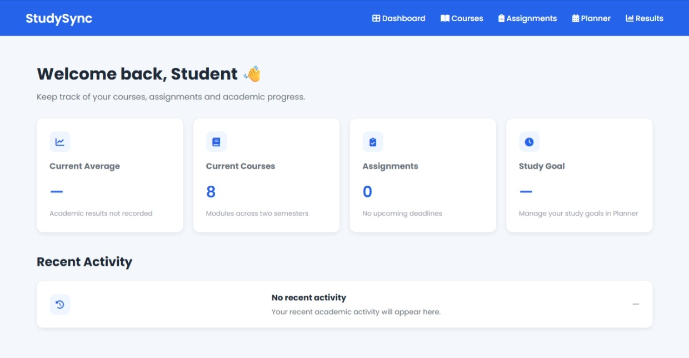
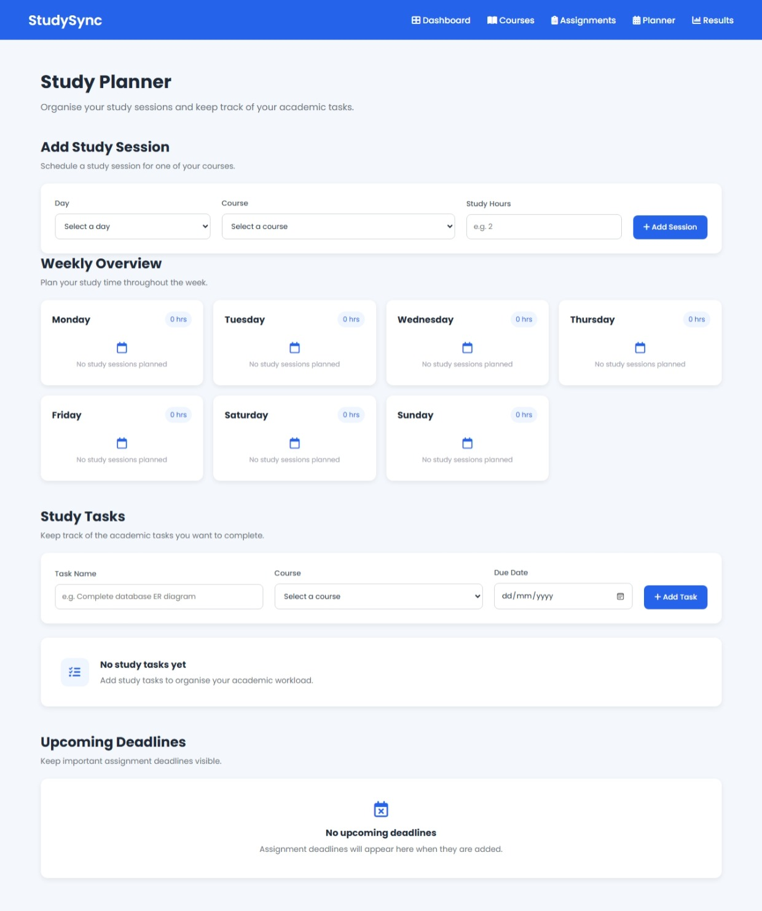
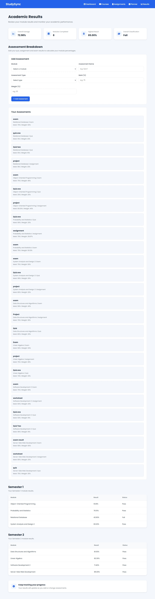

# StudySync – Student Academic Dashboard


StudySync is a student academic dashboard designed to help students organise their studies, manage assignments, plan study sessions and track their academic performance.


## Live Demo


[Visit StudySync](https://codewithdavid-lang.github.io/StudySync/)


## Features


- **Dashboard:** Provides an overview of academic activities.

- **Courses:** Displays modules organised by semester.

- **Assignments:** Helps students keep track of assignments and deadlines.

- **Study Planner:** Allows students to organise study sessions and manage study tasks.

- **Academic Results:** Allows students to record assessment marks, calculate weighted results and monitor academic progress.


## Screenshots


### Dashboard





### Study Planner





### Academic Results





## Technologies Used


- HTML5

- CSS3

- JavaScript

- Browser Local Storage

- Git and GitHub


## Data Storage


Study sessions, tasks and assessment records are stored locally in the browser using Local Storage.


Data is not automatically synchronised between different browsers or devices.


## Project Structure


```text

StudySync/

├── index.html

├── courses.html

├── assignments.html

├── planner.html

├── results.html

├── style.css

├── script.js

├── README.md

└── images/

    ├── dashboard.jpg

    ├── planner.jpg

    └── results.jpg

```


## Author


**David Adesokan**


BSc Computer Science Student


